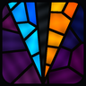
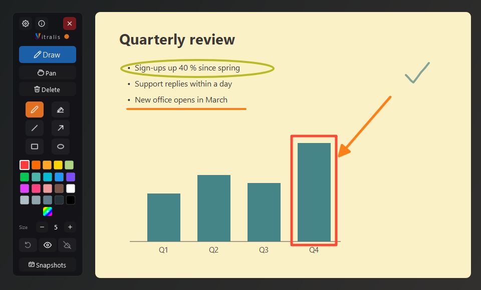
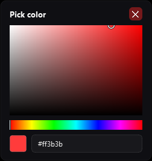
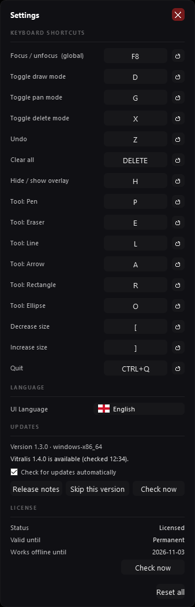
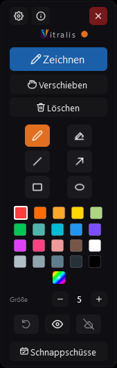

[//]: # ( ---------------------------------------------------------------------- )
[//]: # (+ Authors: 	Ran# <ran.hash@proton.me> )
[//]: # (+ Created: 	2026/04/27 10:48:03.565778 )
[//]: # (+ Revised: 	2026/11/21 18:29:12.167582 )
[//]: # ( ---------------------------------------------------------------------- )

<div align="center">



# Vitralis

### Your screen, with memory

Draw notes, arrows and shapes right on top of whatever is on your Windows screen, for teaching, presenting or
explaining something on a call. Your drawings stay where you put them, across restarts, until you remove them,
and the rest of the time your clicks go straight through them.

<br>

[](https://github.com/Ran-n/vitralis/releases/latest)

[](https://github.com/Ran-n/vitralis/releases)
[](https://gitlab.com/Ran-n/vitralis/-/releases)
[](https://codeberg.org/ran-n/vitralis/releases)

[](https://github.com/Ran-n/vitralis/releases/latest)
[](#download-and-install)
[](docs/user-guide.md)
[](LICENSE)

<br>



[Why Vitralis?](#why-vitralis) · [A closer look](#a-closer-look) · [A session](#a-session-in-vitralis) · [Download](#download-and-install) · [Getting started](#getting-started) · [Your data](#privacy-and-your-data) · [Questions](#questions) · [From source](#run-from-source) · [Technical details](#technical-details) · [License](#license)

</div>

---

## Why Vitralis?

Pointing at things on a screen is hard: a mouse cursor is small, and a screenshot you annotate is out of date the
moment you take it. Vitralis lets you draw on the live screen itself, over any window, and keeps your drawings
there for as long as you need them.

- **Mark up anything on your screen.** Pen, line, arrow, rectangle, ellipse and eraser, in any colour, over any app, video or slide.
- **Your notes stay.** Close Vitralis or restart the computer: your drawings are where you left them, on each monitor, until you clear them.
- **Never in your way.** When you aren't drawing, clicks go straight through to the windows underneath.
- **Keep sets of drawings.** Save everything on screen as a named snapshot and bring it back later.
- **Speaks your language.** English, Galician (both spellings), Spanish, Portuguese, French, German, Chinese and Japanese.
- **Keeps itself up to date.** It tells you when a new version is out and installs it with one click, checking first that it really comes from its author.

---

## A closer look

Vitralis is a small toolbar that floats over your screen, and a see-through layer over every monitor that holds
what you draw.

| Part | What it's for |
|---|---|
| **Toolbar** | Start and stop drawing, pick a tool, a colour and a size, undo, hide the drawings |
| **Overlay** | Shows your drawings on every monitor; clicks pass through it unless you're drawing |
| **Snapshots** | Save the drawings on screen under a name and load them back |
| **Settings** | Your own keyboard shortcuts, the language, updates and the license |
| **About** | The version, the author and the project's links |

<table>
<tr>
<td align="center"><br><b>Draw</b><br>Pick a tool and a colour; draw for as long as you like</td>
<td align="center"><br><b>Any colour</b><br>Pick a shade or type its code</td>
</tr>
<tr>
<td align="center"><br><b>Snapshots</b><br>Save the drawings under a name and load them back</td>
<td align="center"><br><b>About</b><br>Version, author and links</td>
</tr>
<tr>
<td align="center"><br><b>Settings</b><br>Your own shortcuts, the language, updates and the license</td>
<td align="center"> <br><b>In your language</b><br>Japanese and German here, nine in all</td>
</tr>
</table>

Drawing stays on for as many strokes as you like; a right-click or `Esc` ends it. `F8` brings the toolbar forward
from any app, and the scroll wheel cycles through the colours while you draw. Plug a monitor in or out and the
overlay follows.

---

## A session in Vitralis

1. You're about to walk a colleague through a chart on a call. You press **Draw** (or `D`); the toolbar lights up.
2. You pick the **ellipse** and the green swatch, and circle the first point of the slide.
3. You switch to the **arrow** in orange and point from the empty space to the tallest bar, then frame that bar with a red **rectangle**.
4. A wrong stroke? **Undo** (`Z`) takes back the last one, whichever monitor it's on.
5. You right-click: drawing ends, and your clicks reach the slide again while the notes stay on top.
6. Before the next slide you save the notes as a snapshot named "Q4 review", clear the screen with `Del`, and load the snapshot again when someone asks.

---

## Download and install

Get it from the [latest release](https://github.com/Ran-n/vitralis/releases/latest), also on
[GitLab](https://gitlab.com/Ran-n/vitralis/-/releases) and [Codeberg](https://codeberg.org/ran-n/vitralis/releases).

| System | File | What it is |
|---|---|---|
| Windows 10 (1809) or later, 64-bit | `vitralis-<version>-windows-x86_64-setup.exe` | **The installer. Pick this one on Windows.** It installs for your account only, with no administrator password, adds Vitralis to the Start menu, can add a desktop shortcut and start Vitralis when you sign in, and comes with an uninstaller. |
| Windows 10 (1809) or later, 64-bit | `vitralis-<version>-windows-x86_64-portable.exe` | The portable version: one file that runs from any folder of your own and installs nothing. |

Both update themselves from inside the app. Your drawings, snapshots, settings and license survive every update,
and uninstalling too.

> [!NOTE]
> Windows: Vitralis isn't code-signed for Windows, so SmartScreen may say "Windows protected your PC" the first time. Click **More info**, then **Run anyway**.

<details>
<summary><b>Check that a download is genuine</b></summary>

Every file of a release has two files beside it: `<file>.b3`, its BLAKE3 checksum, and `<file>.minisig`, its
signature by Vitralis's release key (the signature the in-app updater checks before installing anything).

```
b3sum --check vitralis-<version>-windows-x86_64-setup.exe.b3
minisign -Vm vitralis-<version>-windows-x86_64-setup.exe -P RWTznxbopCddnGW7bJg4J1HdisbXbwhpTLVL15NOpaFJ1U8BNastzaxb
gh attestation verify vitralis-<version>-windows-x86_64-setup.exe --repo Ran-n/vitralis
```

The second line checks the signature with [minisign](https://jedisct1.github.io/minisign/) and Vitralis's
release key; its output also shows the trusted comment, which names the version and the file. If a release was
signed with the backup key instead, check it with that one:

| Release key | |
|---|---|
| Signing key | `RWTznxbopCddnGW7bJg4J1HdisbXbwhpTLVL15NOpaFJ1U8BNastzaxb` |
| Backup key | `RWQdjNahwhlUZDA5Rp75iKxM04xPAqMTos/g4OFWNuoQiRU/uELuToqD` |

The third line checks GitHub's record that the file was built by the project's release workflow.
</details>

---

## Getting started

1. Run the installer (or the portable exe). The toolbar appears near the corner of your main screen.
2. Enter your license key and press **Activate** (no key yet? write to ran.hash@proton.me).
3. Press **Draw** (or `D`), pick a tool and a colour, and draw anywhere on the screen.
4. Right-click or press `Esc` to stop drawing: your clicks go through to the windows again, and the drawings stay.
5. Press `F8` from any app to bring the toolbar forward; **Settings** lets you change every shortcut.

Everything else (tools, snapshots, shortcuts, updates, and what to do when something goes wrong) is in the
[user guide](docs/user-guide.md).

---

## Privacy and your data

- **No account, no telemetry.** Vitralis sends nothing about what you draw or do.
- **The license is checked online.** Breren's license server (`clavren.breren.com`) is asked when you activate and once a day, with the key, this computer's name and the app version. Vitralis keeps working offline for up to 30 days.
- **The update check sends nothing about you.** Once a day it asks GitHub and GitLab for the latest release. Turn it off in **Settings › Updates**.
- **Your drawings stay on your computer,** in `%APPDATA%\Vitralis`, with your snapshots, settings and log. Uninstalling keeps them.

> [!WARNING]
> **Clear all** (`Del`) removes every drawing on every screen at once. Save a snapshot first if you may want them back.

---

## Questions

<details>
<summary><b>Is it free?</b></summary>

Free for personal, academic and non-commercial use. Using it commercially needs a revenue-share agreement with
the author. The [PayBack License (PBL) v2.0](LICENSE) has the exact terms.
</details>

<details>
<summary><b>Do I need an account or a key?</b></summary>

No account. You need a license key, which you enter once on each computer; ask ran.hash@proton.me for one.
</details>

<details>
<summary><b>What can I draw over?</b></summary>

Anything on your Windows desktop: any app, browser, video or slide show, on every monitor you have.
</details>

<details>
<summary><b>Which computers does it run on?</b></summary>

Windows 10 (version 1809) or later, 64-bit. Vitralis draws over the Windows desktop and uses Windows to let
clicks pass through, so there is no Mac or Linux version.
</details>

<details>
<summary><b>Does it replace a whiteboard app?</b></summary>

No: it draws over what is already on your screen. For a blank page, draw over any empty window.
</details>

<details>
<summary><b>How do I update it?</b></summary>

Vitralis checks once a day. When a new version is out, the Settings button gets a dot; open **Settings ›
Updates** and press **Update and restart**. It checks the download is genuine before installing it.
</details>

<details>
<summary><b>I can't see the toolbar.</b></summary>

Press `F8`, or use **Show toolbar** in the Vitralis icon's menu in the notification area. More fixes are in the
user guide's [Troubleshooting](docs/user-guide.md#troubleshooting).
</details>

<details>
<summary><b>What does the name mean?</b></summary>

*Vitral* is stained glass in Galician, Spanish and Portuguese: a pane of glass you see through, with colour on it.
That's what Vitralis puts over your screen, and why its logo is a V in stained glass.
</details>

<details>
<summary><b>Where do I report a problem?</b></summary>

Open an issue on [GitHub](https://github.com/Ran-n/vitralis/issues),
[GitLab](https://gitlab.com/Ran-n/vitralis/-/issues) or [Codeberg](https://codeberg.org/ran-n/vitralis/issues)
(see [Reporting Bugs](CONTRIBUTING.md#reporting-bugs)), and attach `%APPDATA%\Vitralis\vitralis.log` if you can.
</details>

---

## Run from source

You need Windows, [Python 3.13](https://www.python.org/) and [uv](https://docs.astral.sh/uv/).

```
git clone https://github.com/Ran-n/vitralis.git
cd vitralis
uv run vitralis
```

A copy run from source never updates itself: update it with `git pull`.

**Test it**

```
uv run pytest --cov
```

**Build it** (the exe and, with [Inno Setup 6](https://jrsoftware.org/isinfo.php), the installer, in `dist/`)

```
uv run build
```

The [development guide](docs/development.md) has the rest: the code's layout, every kind of test, the installer
and releases.

---

## Contributing

Contributions are welcome; [CONTRIBUTING.md](CONTRIBUTING.md) explains how to report a bug, suggest a feature or
send a change. Contributors are recorded in [CONTRIBUTORS](CONTRIBUTORS), which is also the license's
revenue-share record.

---

## Technical details

| Document | What's in it |
|---|---|
| [docs/user-guide.md](docs/user-guide.md) | Every feature, the keyboard shortcuts, the license, updates, where your data lives, and troubleshooting |
| [docs/development.md](docs/development.md) | Running from source, the code's layout, tests, building, the installer and releases |
| [docs/design-decisions.md](docs/design-decisions.md) | Why the updater and the About window work the way they do |
| [CONTRIBUTING.md](CONTRIBUTING.md) | How to report a bug, suggest a feature or send a change |
| [CHANGELOG.md](CHANGELOG.md) | What changed in each version |
| [CONTRIBUTORS](CONTRIBUTORS) | Who contributed, and the license's revenue-share record |
| [TODO.md](TODO.md) | What's planned next |
| [THIRD-PARTY-NOTICES.md](THIRD-PARTY-NOTICES.md) | The licenses of the code and icons Vitralis is built with |

**Built with** Python, Qt 6 (PyQt6), httpx, cryptography and BLAKE3, packaged with PyInstaller and Inno Setup.

**Credits:** toolbar icons from or after [Feather](https://feathericons.com/) (MIT) and
[Lucide](https://lucide.dev/) (ISC); see [THIRD-PARTY-NOTICES.md](THIRD-PARTY-NOTICES.md).

---

## License

[PayBack License (PBL) v2.0](LICENSE): free for personal, academic and non-commercial use; commercial use needs a
revenue-share agreement with the author.

---

<div align="center">

<a href="https://breren.com"></a>

Made by **[Breren](https://breren.com)**

</div>
