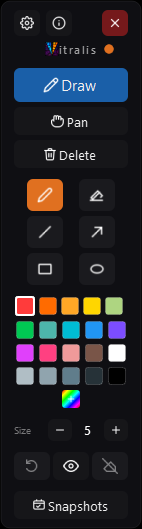
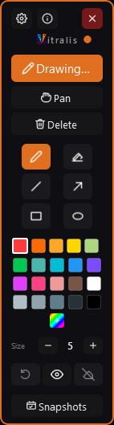
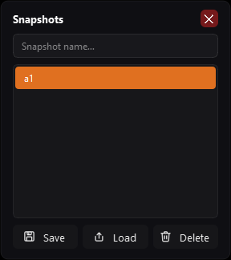
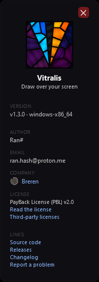
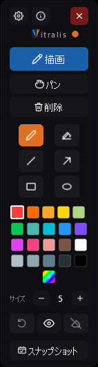

[//]: # ( ---------------------------------------------------------------------- )
[//]: # (+ Authors: 	Ran# <ran.hash@proton.me> )
[//]: # (+ Created: 	2026/04/27 10:48:03.565778 )
[//]: # (+ Revised: 	2026/11/15 16:41:04.941911 )
[//]: # ( ---------------------------------------------------------------------- )

<div align="center">


# Vitralis

**Your screen, with memory.**

Draw notes, arrows and shapes right on top of whatever is on your Windows screen. They stay there, across restarts, until you remove them, and the rest of the time you click straight through them.

<br>

[](https://github.com/Ran-n/vitralis/releases/latest)

[](https://github.com/Ran-n/vitralis/releases)
[](https://gitlab.com/Ran-n/vitralis/-/releases)
[](https://codeberg.org/ran-n/vitralis/releases)

[](https://github.com/Ran-n/vitralis/releases/latest)


[](LICENSE)

<br>



[Why Vitralis?](#why-vitralis) · [A closer look](#a-closer-look) · [Download and install](#download-and-install) · [Getting started](#getting-started) · [Your data](#your-data) · [Questions](#questions) · [From source](#install-or-run-from-source) · [Technical details](#technical-details) · [License](#license)

</div>

## Why Vitralis?

- **Mark up anything on your screen.** Pen, line, arrow, rectangle, ellipse and eraser, in any colour, over any app, video or slide.
- **Your notes stay.** Close Vitralis, restart the computer: your drawings are where you left them, on each monitor, until you clear them.
- **Never in your way.** When you aren't drawing, clicks go straight through to the windows underneath.
- **Keep sets of drawings.** Save everything on screen as a named snapshot and bring it back later.
- **Speaks your language.** English, Galician (both spellings), Spanish, Portuguese, French, German, Chinese and Japanese.
- **Keeps itself up to date.** It tells you when a new version is out and installs it with one click, checking it really comes from its author.

## A closer look

<table>
<tr>
<td align="center"><br><b>Draw</b><br>Pick a tool and a colour; draw for as long as you like</td>
<td align="center"><br><b>Any colour</b><br>Pick a shade or type its code</td>
</tr>
<tr>
<td align="center"><br><b>Snapshots</b><br>Save the drawings under a name and load them back</td>
<td align="center"><br><b>About</b><br>Version, author and links</td>
</tr>
<tr>
<td align="center"><br><b>Settings</b><br>Your own shortcuts, the language, updates and the license</td>
<td align="center"> <br><b>In your language</b><br>Japanese and German here, nine in all</td>
</tr>
</table>

## Download and install

Get it from the [latest release](https://github.com/Ran-n/vitralis/releases/latest). Vitralis runs on Windows 10 (version 1809) or later, 64-bit.

| You want | Download |
|---|---|
| Vitralis installed, in the Start menu (recommended) | `vitralis-<version>-windows-x86_64-setup.exe` |
| One file to run from a folder of your own, nothing installed | `vitralis-<version>-windows-x86_64.exe` |

The installer needs no administrator rights and installs for your account only. Both copies update themselves.

> [!NOTE]
> Windows may show "Windows protected your PC" the first time, because Vitralis isn't signed with a paid Microsoft certificate. Click **More info**, then **Run anyway**. Each release file has a `.b3` checksum next to it if you want to check your download (`b3sum -c <file>.b3`).

## Getting started

1. Run the installer (or the portable exe). The toolbar appears near the corner of your main screen.
2. Enter your license key and press **Activate** (no key yet? write to ran.hash@proton.me).
3. Press **Draw** (or `D`), pick a tool and a colour, and draw anywhere on the screen.
4. Right-click or press `Esc` to stop drawing: your clicks go through to the windows again, and the drawings stay.
5. Press `F8` from any app to bring the toolbar forward; **Settings** lets you change every shortcut.

Everything else (tools, snapshots, shortcuts, updates) is in the [user guide](docs/user-guide.md).

## Your data

- Your drawings, snapshots and settings stay on your computer, in `%APPDATA%\Vitralis`. Uninstalling keeps them.
- The license is checked with Breren's license server (`clavren.breren.com`) when you activate and once a day: it sends the key, this computer's name and the app version. It keeps working offline for up to 30 days.
- The update check asks GitHub and GitLab for the latest release once a day and sends nothing about you. Turn it off in **Settings → Updates**.

> [!WARNING]
> **Clear all** (`Del`) removes every drawing on every screen at once. Save a snapshot first if you may want them back.

## Questions

<details>
<summary><b>Is it free?</b></summary>

Free for personal, academic and non-commercial use. Using it commercially needs a revenue-share agreement with the author. The [PayBack License (PBL) v2.0](LICENSE) has the exact terms.
</details>

<details>
<summary><b>Does it work on Mac or Linux?</b></summary>

No. Vitralis draws over the Windows desktop and uses Windows to let clicks pass through, so it is Windows only.
</details>

<details>
<summary><b>Can I use it on more than one computer?</b></summary>

A license key works on the first computer it is activated on. After a reinstall or on a new computer, ask for a reset and enter the same key again.
</details>

<details>
<summary><b>Will it get in the way of my work?</b></summary>

No. Outside draw mode the overlay lets every click and scroll through, and the toolbar can be hidden; drawings are kept either way.
</details>

<details>
<summary><b>How do I know an update is genuine?</b></summary>

Vitralis checks that each update is signed with its author's release key before it downloads it, and checks the download against its checksum before installing it. Anything else is refused and deleted.
</details>

<details>
<summary><b>Where do I report a problem?</b></summary>

Open an issue on [GitHub](https://github.com/Ran-n/vitralis/issues) (see [Reporting Bugs](CONTRIBUTING.md#reporting-bugs)), and attach `%APPDATA%\Vitralis\vitralis.log` if you can.
</details>

## Install or run from source

You need Windows, [Python 3.13](https://www.python.org/) and [uv](https://docs.astral.sh/uv/).

```
git clone https://github.com/Ran-n/vitralis.git
cd vitralis
uv sync
```

**Run it:** `uv run vitralis`. A copy run from source never updates itself: update it with `git pull`.

**Install it:** `uv run build` makes the exe and the installer in `dist/` ([Inno Setup 6](https://jrsoftware.org/isinfo.php) needed for the installer). The [development guide](docs/development.md#build) has the details.

## Technical details

| Document | What is in it |
|---|---|
| [docs/user-guide.md](docs/user-guide.md) | Every feature, the keyboard shortcuts, the license, updates, and where your data lives |
| [docs/development.md](docs/development.md) | Running from source, the code's layout, tests, building, the installer and releases |
| [docs/design-decisions.md](docs/design-decisions.md) | Why the updater and the About window work the way they do |
| [CONTRIBUTING.md](CONTRIBUTING.md) | How to report a bug, suggest a feature or send a change |
| [CHANGELOG.md](CHANGELOG.md) | What changed in each version |
| [THIRD-PARTY-NOTICES.md](THIRD-PARTY-NOTICES.md) | The licenses of the code Vitralis is built with |

**Built with** Python, Qt 6 (PyQt6), httpx, cryptography and BLAKE3, packaged with PyInstaller and Inno Setup.

## License

[PayBack License (PBL) v2.0](LICENSE): free for personal, academic and non-commercial use; commercial use needs a revenue-share agreement with the author. Vitralis is made by Ran# and published by [Breren](https://breren.com).
